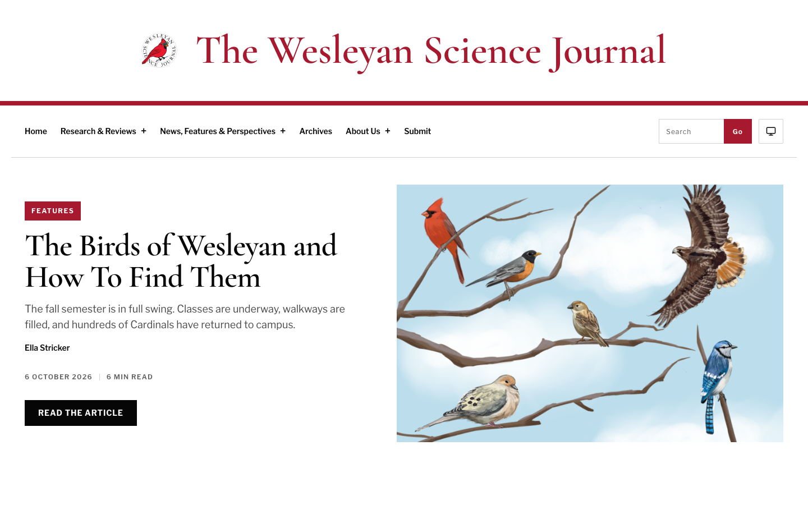
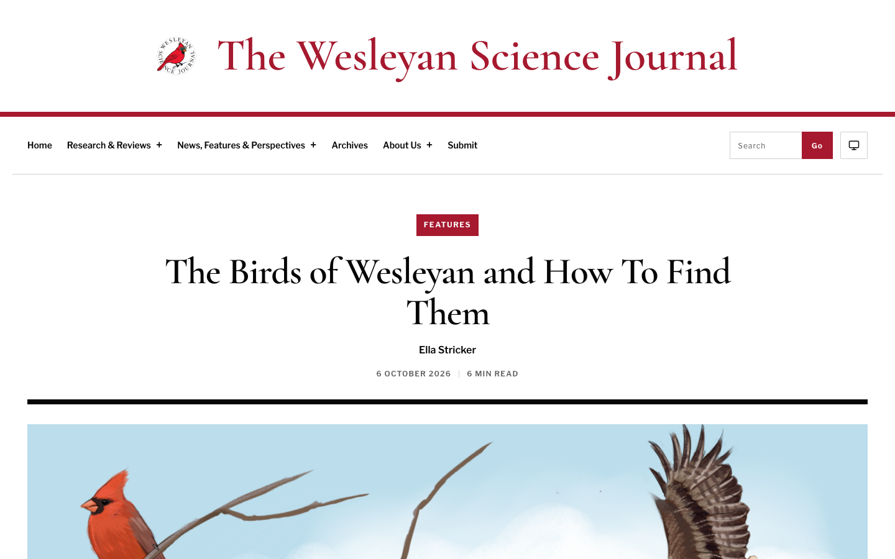
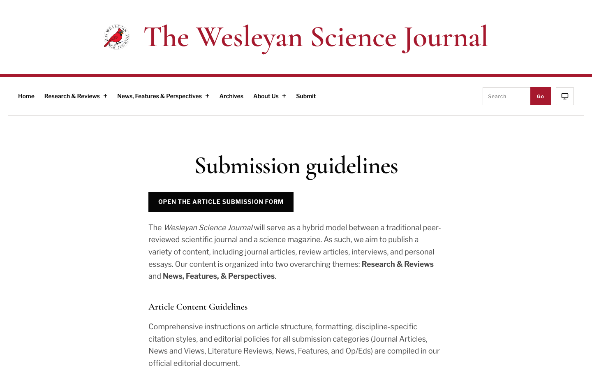
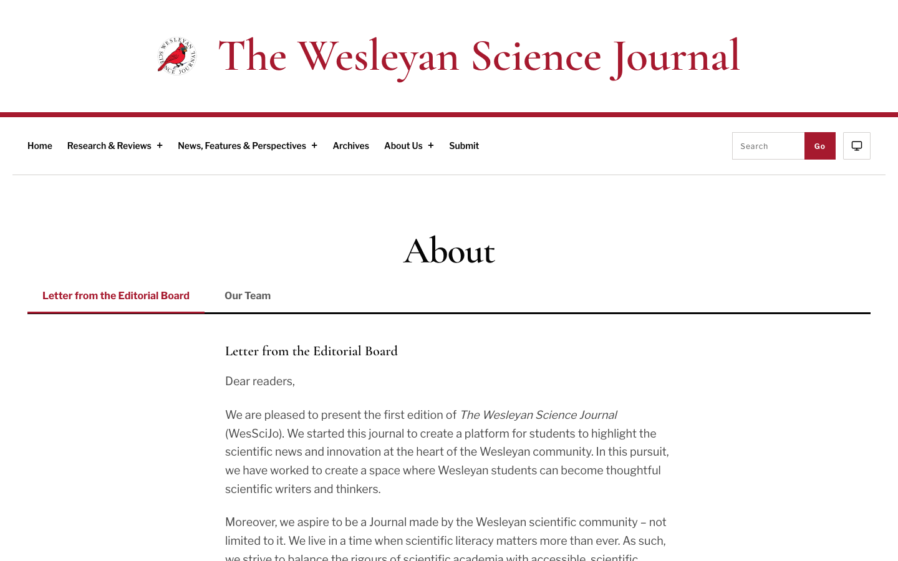
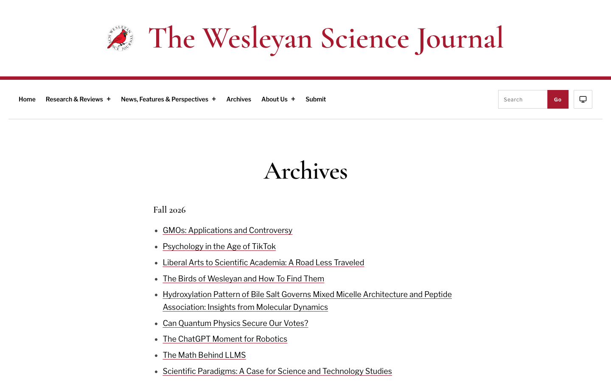

# WesSciJo

The codebase for [The Wesleyan Science Journal](https://thewesleyansciencejournal.com/), Wesleyan University's student-run science publication. Production runs on WordPress. This repository contains its theme, editorial workflow plugin, a static publication preview, and the source content for the Fall 2026 issue.

## Live site

The current edition is live at [thewesleyansciencejournal.com](https://thewesleyansciencejournal.com/).

### Homepage


[View the full homepage capture](screenshots/live-site/01-homepage-full.png).

### Article reading view


### Submission guidelines and about page



### Archives


## How this repo works

WordPress serves the public site and gives the editorial team its publishing workspace. The repository also keeps a static publication build for local previews and content checks.

### 1. The static publication is a preview
The `public/` directory contains a generated edition of the journal. The standard-library Python renderer (`scripts/render-publication.py`) reads articles and issue notes from `content/issue-2026/` and writes static HTML, CSS, and search data. This build does not update the production WordPress site.

### 2. WordPress serves the journal
The `plugins/wessci-site/` companion plugin adds editorial tools to WordPress:

- Custom workflow statuses: `in_review`, `copyediting`, and `ready_for_issue`.
- Article metadata fields for author credentials, figures, captions, licenses, and references.
- An issue assembly widget that tracks published, ready, and in-progress articles.
- Masthead management for the editorial roster.

The WordPress themes live in `themes/wesscijo/` (the active theme) and `themes/wessci-fallback/` (a matched backup theme kept in sync for disaster recovery).

### 3. The sync rule
Changes made in WordPress do not automatically update the static preview. When an editorial change is approved for the preview, update `content/issue-2026/`, rerender `public/`, and verify the output. Deploying the WordPress theme is a separate step.

## Quick start

Python 3 can build and serve the static preview on a development host:

```sh
python3 scripts/render-publication.py
python3 -m http.server 8000 -d public
```

Open `http://localhost:8000` in your browser.

### Running automated browser checks

Playwright tests verify article routes, navigation, search filtering, and responsive layouts:

```sh
PUBLICATION_BASE_URL=http://localhost:8000 npx playwright test tests/editorial-publication.spec.js
WORDPRESS_PREVIEW_URL=http://localhost:8888 npx playwright test tests/editorial-wordpress.spec.js
```

### Syncing the fallback theme

Whenever you update templates or styles in `themes/wesscijo/`, run the promotion script to mirror those changes to `themes/wessci-fallback/`:

```sh
bash scripts/promote-to-fallback.sh
```

## Fall 2026 issue contents

The source snapshot in `content/issue-2026/` includes nine articles in the site's two editorial sections:

- **Research & Reviews:** *GMOs: Applications and Controversy*; *Hydroxylation Pattern of Bile Salt Governs Mixed Micelle Architecture and Peptide Association*; *Can Quantum Physics Secure Our Votes?*; and *The Math Behind LLMS*.
- **News, Features & Perspectives:** *The Birds of Wesleyan and How To Find Them*; *Psychology in the Age of TikTok*; *Liberal Arts to Scientific Academia: A Road Less Traveled*; *The ChatGPT Moment for Robotics*; and *Scientific Paradigms: A Case for Science and Technology Studies*.

The issue also includes the Editorial Board letter, division landing pages, full site search, and submission guidelines with the official Google Form intake.

## Other folders

- `preview/`: Standalone design previews, including the source preview for the cardinal entrance animation. The separate Cardinal site concept uses sample articles.
- `brand/`: Source assets for the official journal seal, with a goggled cardinal perched on a syringe.
- `tests/`: End-to-end browser specs, WordPress Playground blueprints, and syntax checks.

## Follow-up items

Some image attributions remain unresolved in `content/issue-2026/source-notes.json`. Keep the supplied credits intact until the editors confirm the missing ones.
